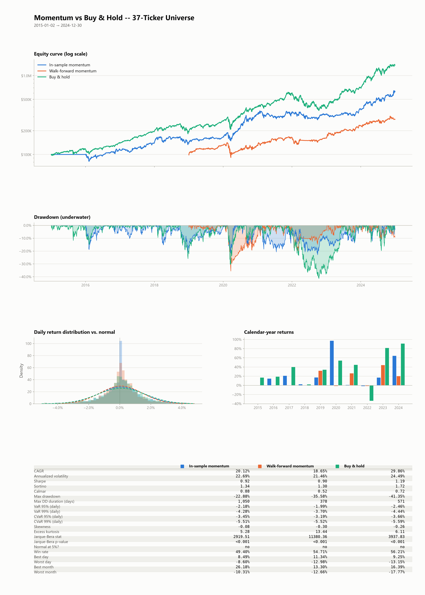

# Momentum's Drawdown Protection Is a US Phenomenon

An event-driven backtesting engine built from scratch, used to test whether cross-sectional momentum's regime-dependent behaviour replicates outside the United States.

The pattern holds in the US sample. It does not replicate in Europe or emerging markets.

## Motivation

Cross-sectional momentum is one of the most documented anomalies in asset pricing, and a common claim about it is that it cushions equity drawdowns: the strategy rotates out of falling names and into whatever is still holding up. Most of the evidence behind that claim comes from US data.

This project builds the infrastructure needed to test the claim properly, then applies it to three universes over 2005-2024.

## Implementation

The engine is written in plain Python with pandas and numpy. No vectorbt, no backtrader. The point was to control the execution model rather than inherit someone else's assumptions about it.

```
quantbt/
├── data/        point-in-time bar delivery from cached yfinance data
├── engine/      event objects, simulated broker, the main loop
├── strategies/  Strategy base class, buy & hold, cross-sectional momentum
├── risk/        position sizing (equal weight, volatility targeting)
├── portfolio/   position and cash bookkeeping, equity curve
├── analytics/   metrics, tearsheet, regime classification, significance tests
└── validation/  walk-forward analysis, stress testing
```

### Execution model

A vectorised backtest computes signals across the whole price series at once. It is fast, and it makes look-ahead bias easy to introduce without noticing, because the array holding day 10 already contains day 500.

This engine advances a clock one bar at a time. A strategy can only reach data through `get_latest_bars()`, which is capped at the current timestamp. There is no API path to future rows. Orders raised on bar *t* fill at the open of bar *t+1*, after slippage and commission.

Three frictions are modelled: a one-bar execution delay, square-root market impact scaled by participation rate, and per-share commission with a minimum. Orders are also capped at 10% of trailing average volume, so the backtest cannot pretend to move size the market would not absorb.

## Data and methodology

**Strategy.** Cross-sectional momentum, 12-1: rank the universe by trailing 252-day return excluding the most recent 21 days, hold the top decile, rebalance monthly. The one-month skip is standard, because short-horizon reversal contaminates the signal.

**Sizing.** Volatility targeting, so a name realising 60% annualised vol receives roughly a third of the capital of one realising 20%.

**Validation.** Walk-forward with a four-year training window and a one-year trading window. Within each training window a parameter grid is swept and the best Sharpe is selected; those parameters then trade the following year without reoptimisation. Only the trading windows are concatenated into the reported equity curve. Two different grids are used in this project, not one: the single-universe validation in Results §1-2 sweeps the full 96-combination grid (four lookbacks, four skip windows, three fractions, two rebalance frequencies) over six folds, 2015-2024; the three-universe regime analysis in §3 onward sweeps a reduced 12-combination grid (three lookbacks, two skips, two fractions, rebalance frequency held at monthly) over sixteen folds, 2005-2024, so that three markets over twenty years stays tractable. Every number below is traceable to one or the other.

**Regimes.** Each day is classified on two axes using SPY as reference: trend (above or below the 200-day moving average) and volatility (21-day realised vol above or below its expanding 75th percentile). The expanding percentile matters. A percentile computed over the full sample would use 2024 information to label a day in 2005.

**Significance.** Block bootstrap with a 20-day block and 5,000 iterations, plus an effective sample size adjusted for autocorrelation. Regimes arrive in contiguous runs and a monthly-rebalanced strategy adds its own serial correlation, so resampling individual days would treat dependent observations as independent and produce confidence intervals that are far too narrow.

## Results

### 1. Effect of out-of-sample validation

The first version of the momentum backtest returned 1,330% over 2015-2024. Two things were wrong with that number.

The volatility-target sizer computed each position's weight independently and never checked the sum. When the top decile held four names and each was allocated 30%, the book ran at 120% exposure. The leverage was accidental and nobody had authorised it. Fixing the sizer to normalise weights across concurrent signals brought the figure to 522%.

Walk-forward validation brought it to 178%, against 1,254% for buy & hold over the same period. The 344 percentage point gap between in-sample and walk-forward is the cost of having chosen parameters with hindsight.

| | Total return | Max drawdown |
|---|---|---|
| Momentum, in-sample | +522.58% | -22.88% |
| Momentum, walk-forward | +178.27% | -35.58% |
| Buy & hold | +1,254.94% | -41.35% |

The strategy did not beat the benchmark out of sample.

### 2. Drawdown behaviour in the US universe

Isolating specific windows separates two behaviours that the regime averages hide.

| Window | Strategy | Return | Max DD | Days to recover |
|---|---|---|---|---|
| COVID crash (Feb-Mar 2020) | Momentum WF | -18.20% | -35.58% | 378 |
| | Buy & hold | -13.46% | -30.28% | 107 |
| 2022 bear market | Momentum WF | -4.81% | -18.24% | 366 |
| | Buy & hold | -33.68% | -40.15% | 525 |

In 2022 momentum lost roughly a seventh of what the benchmark lost. In the COVID crash it lost more and took 378 days to recover against the benchmark's 107.

The COVID result matches the momentum crash mechanism described by Daniel and Moskowitz (2016). Entering February 2020 the portfolio held whatever had risen most over the prior twelve months, which was exactly what fell hardest. By the time the rebound came the strategy had rotated into defensives and missed it. The damage arrives twice.

So "momentum protects in drawdowns" is true on average across US bearish days and misleading about the case that matters most.

### 3. Cross-market replication

Annualised returns by regime, walk-forward momentum, 2005-2024:

| Universe | Bullish, low vol | Bullish, high vol | Bearish, low vol | Bearish, high vol |
|---|---|---|---|---|
| US | 26.75% | 58.00% | -39.21% | -25.33% |
| Europe | 11.68% | 69.09% | -50.42% | -31.89% |
| Emerging | 2.56% | 72.72% | -33.47% | -1.24% |

Comparing regime against regime within one strategy is close to tautological: every strategy earns less in bear markets. The relevant test is whether the *gap* between momentum and buy & hold changes with the regime.

| Universe | Mean daily gap, bullish | Mean daily gap, bearish | Difference | 95% CI | Verdict |
|---|---|---|---|---|---|
| US | -0.065% | +0.058% | -0.122% | [-0.244%, -0.011%] | Significant |
| Europe | -0.014% | -0.091% | +0.077% | [0.001%, 0.159%] | Significant |
| Emerging | -0.033% | +0.002% | -0.035% | [-0.173%, 0.100%] | Not significant |

The US shows the expected pattern with a confidence interval clear of zero. Europe points the other way, and emerging markets cannot be distinguished from noise.

The European result should not be oversold. Its lower bound sits at 0.001%, essentially touching zero, and even after adjusting for autocorrelation the bearish side rests on an effective sample of only around 704 days (n_eff = 703.8, versus 709 raw days) out of sixteen years. It is a weak signal in the opposite direction, not a clean counterexample. What the data supports is that the US pattern replicates in the US and does not appear elsewhere.

### Attribution of cross-market divergence

Two explanations were tested and neither could be isolated.

Parameter selection differs moderately. Europe picks the more concentrated top-decile fraction in 62.5% of folds against 50% in the US, meaning roughly four holdings instead of seven.

Sector composition differs systematically. Across the 33 monthly rebalances falling on bearish days between 2009 and 2024, the US momentum portfolio held consumer cyclicals in 72.7% of those months and technology in 57.6%, against 30.3% and 18.2% for Europe. Europe held healthcare in 81.8% of them against 54.5% for the US.

An earlier version of this analysis concluded that the US captured energy in 2022 and Europe did not. Extending from two snapshots to all 33 bearish rebalances reversed it: Europe carries energy exposure in bearish markets more often than the US, 42.4% against 27.3%. The 2022 episode was a timing coincidence.

The two hypotheses are entangled. More concentrated portfolios amplify whatever sector tilt is present at the time, so both act in the same direction and this experimental design cannot separate them.

### Distributional properties of returns



Jarque-Bera rejects normality at p < 0.001 for all three equity curves, with excess kurtosis between 5 and 13. The Sharpe ratios reported in the tearsheet therefore rest on an assumption the data contradicts. Standard deviation understates risk when it lives in the tails.

Calmar and CVaR are the more informative figures here, and by both the walk-forward strategy's story is mixed rather than one-sided: its max drawdown (-35.58%) is shallower than buy & hold's (-41.35%) and it recovers in roughly two-thirds the time (378 days against 571), but its Calmar ratio (0.52) is still lower than buy & hold's (0.72) because its CAGR gave up more than its drawdown saved. Every risk-adjusted ratio in the tearsheet's table — Sharpe, Sortino, Calmar — favors buy & hold; only the raw drawdown depth and recovery time favor momentum.

Worth noting alongside the headline numbers: the US market spends about 79% of days in a bullish regime. Momentum pays its insurance premium far more often than it collects.

## Limitations

**The universes are not point-in-time.** All three are fixed, current ticker lists. Companies that delisted or went bankrupt never enter the sample, which inflates both the strategy and the benchmark. Building this properly requires historical index constituents, which are commercial data. The emerging universe illustrates the problem directly: several ADRs are absent because of geopolitical delisting, which is survivorship bias visible in the dataset itself.

**One period, one strategy family.** Twenty years, one implementation of one factor. Nothing here says anything about momentum in other decades or about other factors.

**The four-regime scheme collapses to two.** Low-volatility and high-volatility bear markets are statistically indistinguishable in every universe and for both strategies. The volatility axis adds no separation at this sample size.

**Nothing here is an allocation rule.** The results describe how a factor behaved in specific markets over a specific window. Choosing a strategy based on an expected market environment is market timing, and this project provides no evidence that market timing works.

## Reproducing the results

```bash
pip install -r requirements.txt

# Single-universe validation (US, 2015-2024, 96-combination grid, 6 folds) -- Results §1-2
python test_pipeline.py                 # synthetic-data smoke test, no network required
python run_momentum.py                  # in-sample momentum, US universe
python run_walkforward.py               # out-of-sample validation
python run_stress.py                    # COVID / 2022 stress-window drawdown and recovery-time table
python run_tearsheet.py                 # generates tearsheet.png

# Three-universe regime analysis (US/Europe/Emerging, 2005-2024, 12-combination grid, 16 folds) -- Results §3
python run_regimes.py                   # regime breakdown per universe, writes regime_*.csv
python run_significance.py              # block bootstrap: regime vs. regime, within each strategy
python run_interaction_significance.py  # block bootstrap: momentum's edge over buy & hold, by regime
```

Price data is cached as parquet under `cache/` on first download, so subsequent runs need no network access.

## References

Daniel, K. and Moskowitz, T. (2016). Momentum crashes. *Journal of Financial Economics*, 122(2), 221-247.

Jegadeesh, N. and Titman, S. (1993). Returns to buying winners and selling losers. *Journal of Finance*, 48(1), 65-91.
