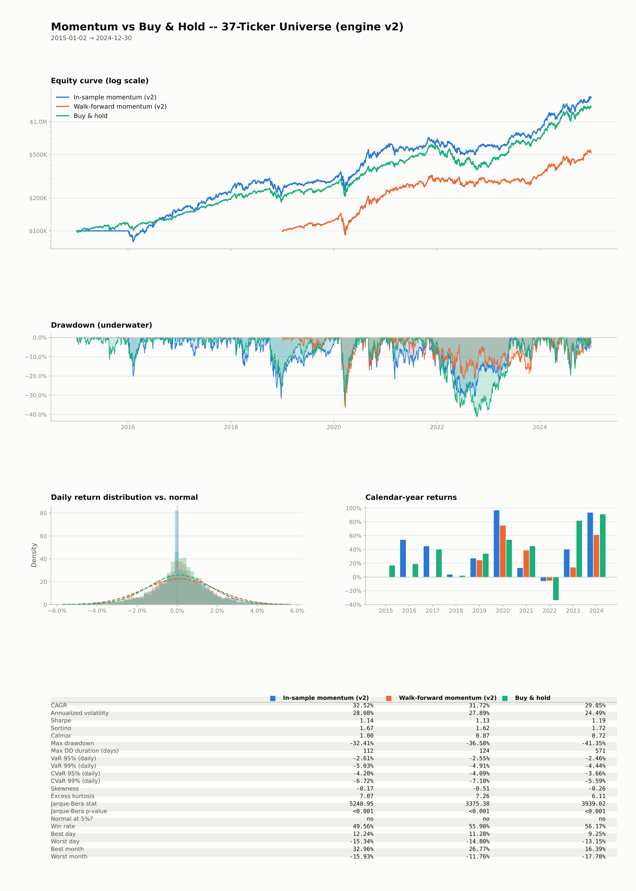

# momentum-regimes

An event-driven backtesting engine written from scratch in Python, and a
study using it: does cross-sectional momentum behave differently from buy &
hold in bull and bear markets?

The short answer, on a point-in-time S&P 500 over 2009–2024, is that
momentum earns about what an equal-weight index earns. In bear markets it
does slightly worse, not better. An earlier version of this project
claimed the opposite. That claim came from a bug in the engine, described
in the Correction section below.

## The engine

`quantbt/` uses plain pandas and numpy, with no backtesting framework.
The point was to control the execution model rather than inherit someone
else's assumptions.

```
quantbt/
├── data/        point-in-time bar delivery; index-membership schedules
├── engine/      events, simulated broker, the event loop
├── strategies/  buy & hold, cross-sectional momentum, short-term reversal,
│                point-in-time and volatility-scaled variants
├── risk/        position sizing (equal weight, volatility targeting)
├── portfolio/   positions, cash, equity curve
├── analytics/   metrics, regimes, block-bootstrap significance, tearsheet, JSON export
└── validation/  walk-forward, walk-forward replay, stress windows
```

- **No look-ahead.** The clock advances one bar at a time. Strategies can
  only read data through `get_latest_bars()`, which is capped at the
  current timestamp. Orders raised on bar *t* fill at the open of *t+1*.
- **Frictions:**
  - square-root market impact plus a spread;
  - per-share commission with a minimum;
  - a cap of 10% of average volume on every order.
- **Walk-forward validation.** Parameters are picked by Sharpe on four
  years of data, then traded unchanged for the next year. Only those
  out-of-sample years are reported.

### How it is checked

- **A golden-fixture regression test.** The default engine path must
  reproduce 5,878 rows of cash, holdings and equity, written by an earlier
  version of the engine, bit for bit.
- **Exact reproduction:**
  - rerunning the original study reproduces every published number;
  - replaying a stored walk-forward from its saved parameters reproduces
    its equity curve to about 1e-16.
- **Factor check.** On the point-in-time S&P 500, momentum's return over
  its benchmark correlates **0.71** (monthly) with the Fama-French
  momentum factor (UMD). Its loading on UMD is 0.46 (t = 30). The engine
  builds real momentum.
- **Tests:** 34, all on synthetic data or committed files, with 92% line
  coverage of `quantbt`. They run in CI on every push.
- **Pre-registered tests.** Every statistical test in the corrected study
  was written down with its pass/fail rule before it ran
  (`HYPOTHESES.md`).

## Method

- **Strategy.** Rank by trailing return over 189–315 days, skipping the
  last 10–21. Hold the top 10–20%. Rebalance monthly.
- **Sizing.** Volatility targeting: weight = min(15% / realised vol, 35%).
- **Walk-forward.** 4-year training and 1-year trading windows, 16 folds,
  2005–2024, with a 12-combination parameter grid.
- **Regimes.** Each day is labelled by SPY's trend (above or below its
  200-day average) and volatility (21-day vol against its *expanding*
  75th percentile, so no label uses future data).
- **The key test.** The *interaction*: momentum's daily excess over its
  benchmark on bullish days, minus the same on bearish days. A
  20-day-block bootstrap with 5,000 draws gives the confidence interval.
  A positive value means momentum does relatively worse in bear markets.

## Results

### Main universe: point-in-time S&P 500

Membership comes from the historical S&P 500 lists in
[fja05680/sp500](https://github.com/fja05680/sp500); prices come from
Yahoo Finance. Twenty renamed tickers are mapped to their current symbol,
each checked on SEC EDGAR (same company record) and for unbroken prices
(`results/pit_us/RENAME_MAP.md`).

> **Coverage gap: 23% of member-days have no price.** Yahoo keeps only
> still-listed symbols, so most acquired and bankrupt members are missing:
> 331 of 943 historical tickers in 2005–2024 (after mapping renames). Coverage rises from 55% of member-days
> in 2005 to 96% in 2024. The missing names are mostly failures, so every
> result below is still biased, just much less than a fixed list of
> today's survivors.

Out of sample, 2009–2024, engine v2, against an equal-weight index of
current members:

| | CAGR | Sharpe | Max drawdown |
|---|---|---|---|
| Momentum (walk-forward) | 14.0% | 0.72 | −35.3% |
| Equal-weight S&P 500 members | 14.0% | 0.81 | −36.1% |

| Interaction (bull − bear, per day) | Estimate | 95% CI |
|---|---|---|
| 2009–2024 | +0.075% | [+0.003%, +0.152%] |
| 2000–2024 (coverage in 2000–04 about 50%) | +0.082% | [+0.023%, +0.130%] |

Momentum does slightly worse relative to the index in bear markets. The
2009–2024 result clears zero only narrowly, so treat it as weak evidence.
The longer sample is clearer. Momentum lost 27% in the dot-com bust
against the index's 10%. It then gained 12% in 2009 against the index's
45%: the rebound "momentum crash" described by Daniel & Moskowitz (2016).

### The 37-name list and other markets

The original study used fixed lists of about 37 large companies chosen in
2025, in each of three markets. These lists are survivors by
construction. Buy & hold of the US list has a Fama-French alpha of 11.8%
a year (t = 4.4), which measures how much hindsight went into choosing
it.

| 2009–2024, engine v2 | Momentum CAGR / Sharpe | Buy & hold CAGR / Sharpe | Interaction | 95% CI |
|---|---|---|---|---|
| US, 37 names | 27.2% / 1.06 | 29.7% / 1.19 | −0.015% | [−0.132, +0.082] |
| Europe, 38 names | 10.8% / 0.61 | 12.8% / 0.78 | +0.070% | [+0.003, +0.136] |
| Emerging, 37 ADRs | 7.1% / 0.38 | 12.6% / 0.60 | +0.023% | [−0.099, +0.141] |

Momentum doesn't beat buy & hold on Sharpe anywhere. Where an interaction
is significant (Europe), it has the same sign as the point-in-time US
result.



*US 37 names, 2015–2024 (a separate 96-combination walk-forward). It
covers the equity curves, drawdowns, return distribution and full
metrics.*

### Other checks

- **2022.** Momentum's one large protective episode came from sector
  allocation. It held 42% energy against the index's 0.7%. Across five US
  bear markets it beat buy & hold in only one other, the global financial
  crisis (`results/bear_episodes/`).
- **Short-term reversal.** None of 24 pre-registered tests comparing
  reversal and momentum across regimes survives a multiple-testing
  correction (`results/reversal/`).
- **Volatility scaling** (Barroso & Santa-Clara 2015), long-only. It cuts
  crash drawdowns on the 37-name list but lowers Sharpe on the
  point-in-time universe (`results/volscaled/`).
- **Robustness.** The null on the 37-name list holds at every trading
  cost from 0 to 50 bp. Momentum's lower realised max drawdown is not
  statistically reliable (`results/robustness_v2/`).

`PAPER_v2.md` has the full write-up, and `web/index.html` is a small
static explorer of the results.

## Correction

The first version of this README was titled *"Momentum's Drawdown
Protection Is a US Phenomenon."* That result was a bug.

Engine v1 didn't let a rebalance spend the cash from that day's sales, so
exit proceeds sat idle until the next rebalance. The momentum book
averaged 67% invested, and a book that is a third cash lags in bull
markets and cushions in bear markets by construction. The fixed engine
(v2, `engine_version="v2"`) is opt-in, and its default path is unchanged.

Under v2, the published US interaction kept 12% of its size and became
insignificant. That is "does not survive" under a decision rule written
before the rerun (`results/v2/FINDINGS_CASH.md`). The original text is in
the git history. `README_v2.md` is the detailed intermediate write-up.

## Limitations

- **Point-in-time only for the US**, and with the 23% coverage gap above.
  Europe and Emerging use fixed present-day lists.
- **Long-only, top-decile books.** These are not factor portfolios. The
  37-name books hold 4–8 names.
- **No FX layer.** European local listings are in local currency.
- **One regime calendar.** SPY regimes are used for every market.
- **Nothing here is an allocation rule.**

## Reproducing

```bash
pip install -r requirements.txt
pytest test_*.py                               # synthetic data, no network

python run_cash_v2.py                          # engine v1 vs v2 on the original study -> results/v2/
python run_regimes_reversal.py                 # reversal vs momentum -> results/reversal/
# point-in-time US (needs a clone of fja05680/sp500):
python build_universe_us.py /path/to/sp500
python build_rename_map.py <saved Wikipedia page> <edgar cache dir>
python run_pit_renamed.py                      # -> results/pit_us_renamed/
python run_pit_2000.py /path/to/sp500          # from 2000 -> results/pit_us_2000/
python run_factor_regressions.py               # -> results/factors/
```

Prices are cached under `cache/` (gitignored). A fresh download reflects
whatever Yahoo serves that day, and Yahoo drops more delisted names over
time.

## References

Barroso, P. and Santa-Clara, P. (2015). Momentum has its moments. *Journal of Financial Economics*, 116(1), 111–120.

Daniel, K. and Moskowitz, T. (2016). Momentum crashes. *Journal of Financial Economics*, 122(2), 221–247.

Fama, E. F. and French, K. R. (2015). A five-factor asset pricing model. *Journal of Financial Economics*, 116(1), 1–22.

Jegadeesh, N. and Titman, S. (1993). Returns to buying winners and selling losers. *Journal of Finance*, 48(1), 65–91.
